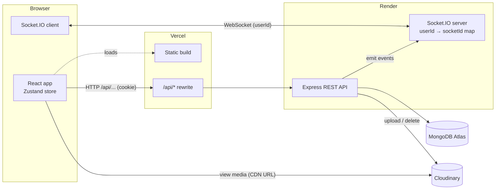
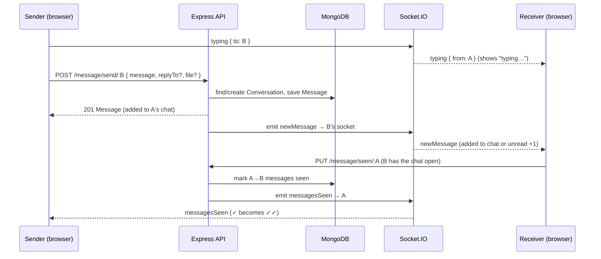
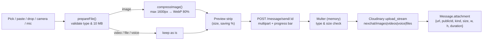
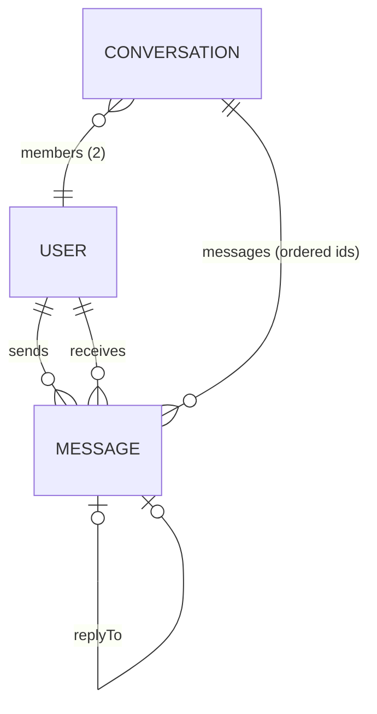

# NexChat

**A real-time messenger built with React, Node.js, Socket.IO, MongoDB and Cloudinary.**

NexChat is a full-stack chat application with instant delivery, live presence, typing indicators, read receipts, replies, reactions, editing, forwarding, voice notes, camera capture, photo and file sharing, profile photos, and light/dark themes. It is designed to feel like a native messenger in the browser while staying within free hosting tiers.

| Service | URL |
|---|---|
| Frontend (Vercel) | https://nex-chat-six.vercel.app |
| Backend API (Render) | https://nexchat-4zi1.onrender.com |
| Repository | https://github.com/Arjun-SN04/NexChat |

---

## Contents

1. [Features](#features)
2. [Tech stack](#tech-stack)
3. [Architecture](#architecture)
4. [How it works](#how-it-works)
5. [Data model](#data-model)
6. [API reference](#api-reference)
7. [Real-time events](#real-time-events)
8. [Project structure](#project-structure)
9. [Getting started](#getting-started)
10. [Deployment](#deployment)
11. [Security](#security)
12. [Limits and known trade-offs](#limits-and-known-trade-offs)
13. [Roadmap](#roadmap)

---

## Features

### Messaging
- **Real-time delivery** over WebSockets (Socket.IO). Messages appear instantly for both people.
- **Replies** to a specific message, shown as a quote. Clicking the quote scrolls to the original and highlights it.
- **Editing** in the main input box (the message is highlighted while you edit). Allowed for **10 minutes** after sending, enforced on the server.
- **Deleting** a single message, several at once, or a whole conversation. Every delete asks for confirmation.
- **Reactions** with emoji (one per person per message; double-click a message for a quick ❤️).
- **Forwarding** one or many messages to up to 20 people at once. Forwarded messages are labelled.
- **Multi-select** mode (hover menu → Select, or long-press on touch) to copy, forward or delete several messages.
- **Copy** message text with one click.
- **Message grouping**: consecutive messages from the same person within 5 minutes are grouped, with date dividers ("Today", "Yesterday", or the date).

### Media
- **Photos, videos and documents** (PDF, Word, Excel, PowerPoint, text, CSV, zip) up to 10 MB. Attach with the paperclip, paste from the clipboard, or drag and drop onto the chat.
- **Camera capture**: take a photo with the device camera (front/back switch on phones), retake or use it.
- **Voice notes**: record up to 2 minutes from the microphone, with an inline player (play/pause, seek, duration).
- **In-browser image compression** before upload (typically 90%+ smaller).
- **Full-screen photo viewer**.

### Presence and status
- **Online indicators** for every contact.
- **Typing indicator** in the chat header, the contact list, and as an animated bubble in the chat.
- **Read receipts**: ✓ sent, ✓✓ seen (updates live when the other person opens the chat).
- **Unread counts** per contact and in the browser tab title, stored on the server so they survive a reload.

### Contacts and navigation
- Contact list with **last message preview** and time, sorted by most recent chat.
- **Search** (press `/` anywhere) and **All / Online / Unread** tabs.
- **Contact info panel** (email, join date, clear chat).
- **Welcome screen** with people who are online right now.
- **Jump to latest** button with a new-message counter when you scroll up.
- **Resizable sidebar** (drag the divider, double-click to reset).
- **Responsive**: one panel at a time on phones, with back navigation.

### Account
- Sign up, sign in, sign out (JWT in an HTTP-only cookie).
- **Profile photo** upload, change and remove (cropped and compressed in the browser).
- Change display name and password.
- **Light and dark themes**, remembered per browser.

### Website
- Landing page with smooth scrolling (Lenis), parallax photos and scroll-in animations.
- Animated page transitions, a page title per screen, and a custom favicon.

---

## Tech stack

### Frontend
| Technology | Purpose |
|---|---|
| React 19 + Vite 7 | UI and build tooling |
| Tailwind CSS v4 (+ daisyUI) | Styling, including a class-based dark mode variant |
| React Router 7 | Routing |
| Zustand | Global chat state (open chat, messages, unread counts, typing, selection, etc.) |
| Socket.IO client | Real-time connection |
| Axios | HTTP requests (with upload progress) |
| React Hook Form | Form validation |
| Motion (Framer Motion) | Page transitions, dialogs and UI animation |
| Lenis | Smooth scrolling on the landing page |
| react-icons (Lucide set) | Icons |
| Browser APIs | `MediaRecorder` (voice), `getUserMedia` (camera/mic), Canvas (image compression), Clipboard |

### Backend
| Technology | Purpose |
|---|---|
| Node.js + Express 5 | REST API |
| Socket.IO | WebSocket server |
| MongoDB Atlas + Mongoose 9 | Database |
| bcryptjs | Password hashing |
| jsonwebtoken + cookie-parser | Authentication |
| Multer | Multipart uploads (kept in memory, streamed to Cloudinary) |
| Cloudinary | Media storage and delivery (CDN) |

### Hosting
| Service | Role |
|---|---|
| Vercel | Frontend (static build + `/api` proxy) |
| Render | Backend (supports long-lived WebSocket connections) |
| MongoDB Atlas | Database |
| Cloudinary (free plan) | Photos, videos, voice notes, files, profile photos |

---

## Architecture



**Two channels, one source of truth.**

- **HTTP (REST)** does every change: send, edit, delete, react, forward, mark as seen, upload. The server validates the request and writes to MongoDB.
- **WebSockets** only push the result of those changes to the *other* person (and presence/typing signals). The sender updates its own screen from the HTTP response.
- In production the browser calls `/api/...` on the Vercel domain and Vercel rewrites it to Render. That keeps the auth cookie **same-site**, so `SameSite=Strict` works. In development, Vite's proxy does the same thing (`/api` → `localhost:3000`).
- The socket connects directly to the backend (`VITE_SOCKET_URL`), identifying itself with the user's id.

### Sending a message (sequence)



---

## How it works

This section explains the approach behind each feature.

### Authentication
- **Sign up** hashes the password with bcrypt (10 salt rounds). **Sign in** compares the hash.
- On success the server signs a **JWT** (`{ user_id }`, valid 10 days) and sets it as an **HTTP-only cookie** (`jwt`, `SameSite=Strict`). JavaScript can't read it, which protects it from XSS.
- Every protected route runs the `secureRoute` middleware. It verifies the cookie, loads the user (without the password) and attaches it as `req.user`.
- The browser keeps a copy of the public user profile in `localStorage` (`chatUser`) so the UI knows who is signed in after a reload. Password hashes are never sent to the browser.
- Logging out clears the cookie, the stored profile, and the chat state.

### Real-time connection and presence
- After sign-in, `SocketProvider` opens one Socket.IO connection with `?userId=...`.
- The server keeps an in-memory map `userId → socketId` and broadcasts the list of online ids (`getOnlineUsers`) whenever someone connects or disconnects. Green dots and the Online tab come from this list.
- To deliver an event to a person, the server looks up their socket id in the map and emits to it.
- All client listeners live in one hook, `useListenMessages`, mounted once by the chat layout. It reads the latest store state with `getState()`, so it never misses events and never registers twice.

### Conversations and messages
- A **Conversation** document links two members and keeps an ordered list of message ids. It is created automatically on the first message.
- Opening a chat loads all its messages (`GET /message/get/:id`).
- **Grouping** is done in the browser. Messages from the same sender, on the same day and within 5 minutes, form a group. Bubble corners and spacing adapt, and the time is shown once per group.
- **Sidebar previews** come from `GET /message/conversations`, which returns the last message and the unread count for each conversation. It is refreshed after edits, deletes and clears. New and sent messages update it instantly.
- **Smart scrolling**: the list jumps to the bottom when you open a chat, follows new messages only if you are already near the bottom (or you sent it), and otherwise shows a "jump to latest" button with a count.

### Typing indicator
- While you type, the composer emits `typing { to }` once, then `stopTyping` after 2.5 s without a keypress, on send, or when you switch chats. The server simply relays these to the other person.
- The receiver shows "typing…" and clears it on `stopTyping`, on the next message, or after a 4 s safety timeout.

### Read receipts and unread counts
- Each message has a `seen` flag. When you open a chat (or come back to the browser tab with it open), the client calls `PUT /message/seen/:id`. The server marks that person's messages to you as seen and emits `messagesSeen` to them, which turns their ✓ into ✓✓.
- Unread counts are computed on the server (`seen: false` messages addressed to you, grouped by sender), so they survive reloads. While you're online, `newMessage` events add to the count instantly.

### Replies, editing and the 10-minute window
- A reply stores `replyTo` (the original message id). The server checks the original belongs to the same two people. The quote is resolved in the browser from the loaded messages, so edits to the original show up in the quote, and a deleted original shows "Original message was deleted".
- Editing loads the text into the main composer with a context strip ("Edit message"). Enter saves, Esc cancels, and ↑ in an empty box edits your last message.
- The **10-minute edit window** is enforced by the server (`EDIT_WINDOW_MS` in `message.controller.js`), so it can't be bypassed. The client mirrors it (`utils/messages.js`) to hide the Edit button, re-checking every 15 s.

### Reactions
- Stored on the message as `reactions: [{ userId, emoji }]`, at most **one per person**. Choosing the same emoji removes it, and a different one replaces it.
- The client updates instantly (optimistic update), then applies the server's answer, and rolls back if the request fails. The other person receives `messageReacted`.
- The server only accepts emoji characters and only from the two people in the chat.

### Selecting, forwarding and deleting
- Selection mode is held in the store (`selectionMode`, `selectedIds`). The composer is replaced by a bar with Copy / Forward / Delete.
- **Bulk delete** (`POST /message/delete-many`) only deletes messages you sent. The other person gets one `messagesDeleted` event.
- **Forward** (`POST /message/forward`) copies messages into each recipient's conversation with `forwarded: true`. **Media is not re-uploaded**: the copies point to the same Cloudinary file, so forwarding costs no extra storage.

### Media pipeline (photos, videos, files, voice notes, camera)



- **Compression happens in the browser** with a canvas. Photos are resized to at most 1600px and re-encoded as WebP (JPEG fallback); a 1.6 MB photo typically becomes about 130 KB. GIFs are left untouched so they still animate, and the original is kept if compression wouldn't help.
- **Camera**: `getUserMedia` streams the camera into a `<video>`. A canvas captures the frame (mirrored for selfies), and the photo goes through the same compression and preview.
- **Voice notes**: `MediaRecorder` records Opus audio at about 32 kbps (roughly 240 KB per minute), with a 2-minute cap (auto-sent at the limit). Cloudinary stores audio as a "video" resource in `nexchat/voice`.
- **Server checks**: Multer accepts only allowed MIME types (no SVG) and at most 10 MB, then the buffer is streamed straight to Cloudinary. Nothing is written to the server's disk.
- **Display**: images are shown from their stored URL with their real aspect ratio (no layout jump), and open in a full-screen viewer. Videos and voice notes use `preload="none"`, so nothing downloads until you press play. Files show a download card.

### Keeping Cloudinary within the free plan
- Compress before upload (photos and profile photos).
- **No Cloudinary transformations** are used (no on-the-fly resizing), so viewing costs only bandwidth, not transformation credits.
- Videos and voice notes load only on play.
- **Deleting frees storage.** Deleting a message, bulk delete, clearing a chat, and replacing or removing a profile photo all delete the file from Cloudinary.
- **Shared files are reference-counted.** Because forwarded copies share one file, it is only deleted once no remaining message uses it (`releaseAttachments`).

### Profile photos
- The browser **centre-crops** the chosen image to a square and shrinks it to 400px WebP (typically a few dozen KB).
- `PUT /user/avatar` uploads it to `nexchat/avatars`, saves `{ url, publicId }` on the user, and deletes the previous photo. `DELETE /user/avatar` removes it and falls back to initials.
- The server broadcasts `userUpdated`, so everyone's contact list, chat header and message avatars update live. Name changes use the same event.

### Theme (light / dark)
- The choice is stored in `localStorage` (`chatTheme`) by `ThemeProvider`.
- In the app screens (chat and profile), `useThemeClass` adds the `dark` class to `<html>`. Tailwind's class-based `dark:` variant then applies everywhere, including dialogs rendered into `<body>` through portals. The landing and sign-in pages stay light.

### Landing page and transitions
- Route changes are wrapped in `AnimatePresence` for fade/slide page transitions. Each page sets its own tab title via `usePageTitle`.
- The landing page uses Lenis for smooth scrolling and Motion for parallax (`useScroll`/`useTransform`) and scroll-in reveals. Both respect the system's *reduce motion* setting.

---

## Data model



**User**
| Field | Type | Notes |
|---|---|---|
| fullName | String | required |
| email | String | required, unique |
| password | String | bcrypt hash, never returned by the API |
| avatar | `{ url, publicId }` \| null | profile photo on Cloudinary |
| createdAt / updatedAt | Date | timestamps |

**Conversation**
| Field | Type | Notes |
|---|---|---|
| members | [ObjectId → User] | the two participants |
| messages | [ObjectId → Message] | in send order |

**Message**
| Field | Type | Notes |
|---|---|---|
| senderId / receiverId | ObjectId → User | |
| message | String | text (may be empty when there is an attachment) |
| edited | Boolean | shows "edited" |
| replyTo | ObjectId → Message \| null | reply target |
| seen | Boolean | read receipt / unread count |
| forwarded | Boolean | shows "Forwarded" |
| reactions | `[{ userId, emoji }]` | one per person |
| attachment | object \| null | `url, publicId, resourceType, kind (image/video/audio/file), name, size, mimeType, width, height, duration` |
| createdAt / updatedAt | Date | timestamps |

---

## API reference

All routes except sign up, sign in and sign out require the `jwt` cookie. The frontend calls them under `/api/...` (proxied).

### Users — `/user`
| Method | Path | Body | Description |
|---|---|---|---|
| POST | `/signup` | `{ fullName, email, password, confirmPassword }` | Create an account and sign in |
| POST | `/login` | `{ email, password }` | Sign in (sets cookie) |
| POST | `/logout` | – | Sign out (clears cookie) |
| GET | `/allusers` | – | Everyone except me |
| GET | `/me` | – | My profile |
| PUT | `/update` | `{ fullName }` or `{ currentPassword, newPassword }` | Update name or password |
| PUT | `/avatar` | multipart `avatar` (JPG/PNG/WebP, ≤ 2 MB) | Upload or replace my profile photo |
| DELETE | `/avatar` | – | Remove my profile photo |

### Messages — `/message`
| Method | Path | Body | Description |
|---|---|---|---|
| GET | `/get/:userId` | – | All messages with a person |
| POST | `/send/:userId` | JSON `{ message, replyTo? }` or multipart `message`, `replyTo?`, `file` | Send text and/or a file |
| PUT | `/edit/:messageId` | `{ message }` | Edit (own message, within 10 min) |
| DELETE | `/delete/:messageId` | – | Delete one of my messages |
| POST | `/delete-many` | `{ ids: [] }` (≤ 50) | Delete several of my messages |
| DELETE | `/conversation/:userId` | – | Clear a conversation (and its files) |
| GET | `/conversations` | – | Last message + unread count per conversation |
| PUT | `/seen/:userId` | – | Mark that person's messages to me as seen |
| POST | `/forward` | `{ messageIds: [], receiverIds: [] }` (≤ 50 / ≤ 20) | Forward messages |
| PUT | `/react/:messageId` | `{ emoji }` | Add, change or remove my reaction |

---

## Real-time events

The socket connects with `?userId=<id>`.

| Event | Direction | Payload | Purpose |
|---|---|---|---|
| `getOnlineUsers` | server → all | `[userId]` | Online presence |
| `newUserJoined` | server → all | user | New sign-up appears in contact lists |
| `userUpdated` | server → all | user | Name or profile photo changed |
| `newMessage` | server → receiver | message | New (or forwarded) message |
| `messageEdited` | server → receiver | message | A message was edited |
| `messageDeleted` | server → receiver | messageId | One message deleted |
| `messagesDeleted` | server → receiver | `[messageId]` | Several messages deleted |
| `conversationDeleted` | server → receiver | `{ otherUserId }` | Chat cleared |
| `messagesSeen` | server → sender | `{ by }` | Turn ✓ into ✓✓ |
| `messageReacted` | server → other person | `{ messageId, reactions }` | Reaction changed |
| `typing` / `stopTyping` | client → server → receiver | `{ to }` → `{ from }` | Typing indicator |

---

## Project structure

```
NexChat/
├── service.sh                     # Start/stop backend + frontend in the background (logs in ./logs)
├── render.yaml                    # Render blueprint for the backend
├── backend/
│   ├── index.js                   # Express app, CORS, routes, MongoDB connection
│   ├── config/cloudinary.js       # Cloudinary config, Multer filters, upload/delete helpers
│   ├── controller/
│   │   ├── user.controller.js     # Auth, profile, profile photo
│   │   └── message.controller.js  # Send, edit, delete, seen, forward, react, summaries
│   ├── models/                    # user, conversation, message (Mongoose)
│   ├── routes/                    # /user and /message routers
│   ├── middleware/secureRoute.js  # JWT cookie check → req.user
│   ├── jwt/token.js               # Sign JWT and set the cookie
│   ├── socket/socket.js           # Socket.IO server, presence map, typing relay
│   └── seed.js                    # Sample users and conversations
└── frontend/
    ├── index.html                 # Fonts, favicon, meta
    ├── public/                    # favicon.svg, site.webmanifest, images/ (Unsplash photos + CREDITS.md)
    ├── vercel.json                # SPA routing + /api proxy to Render
    ├── vite.config.js             # Dev proxy /api → localhost:3000
    └── src/
        ├── App.jsx                # Routes + page transitions
        ├── index.css              # Tailwind, dark variant, chat background pattern
        ├── components/            # Landing, sign in/up, profile, shared UI (Button, Input, Card, …)
        ├── home/
        │   ├── ChatLayout.jsx     # Chat screen shell: theme, socket listeners, resizable sidebar
        │   ├── Avatar.jsx         # Photo or initials + online dot
        │   ├── ConfirmDialog.jsx  # Reusable confirmation dialog
        │   ├── leftpart/          # Sidebar: header, search, tabs, contact rows, signed-in user
        │   └── rightPart/         # Chat: header, messages, bubble, composer, dialogs, media
        ├── context/               # Auth, socket, theme providers + data hooks
        ├── hooks/                 # usePageTitle, useThemeClass, useVoiceRecorder
        ├── utils/                 # attachments (compression), conversations, messages (rules)
        └── Zustand/UserConversation.js  # Global chat store
```

---

## Getting started

### Prerequisites
- Node.js 18+ (20+ recommended)
- A MongoDB database (Atlas free tier works)
- A Cloudinary account (free plan works) for media and profile photos

### 1. Clone and install
```bash
git clone https://github.com/Arjun-SN04/NexChat.git
cd NexChat
cd backend && npm install
cd ../frontend && npm install
```

### 2. Configure the backend
Create `backend/.env` (it is git-ignored):
```env
PORT=3000
MONGODB_URI=your_mongodb_connection_string
token=a_long_random_jwt_secret
FRONTEND_URL=http://localhost:5173

CLOUDINARY_CLOUD_NAME=your_cloud_name
CLOUDINARY_API_KEY=your_api_key
CLOUDINARY_API_SECRET=your_api_secret
CLOUDINARY_FOLDER=nexchat          # all media goes under this folder
```

### 3. Run
Run both apps in the background with one command (ports 3000 and 5173 are freed first):
```bash
./service.sh start      # start both
./service.sh status     # is everything running?
./service.sh logs       # follow logs (or: logs backend / logs frontend)
./service.sh stop       # stop both
```
Or run them separately: `npm run dev` in `backend/` and in `frontend/`. Open http://localhost:5173.

### 4. Sample data (optional)
```bash
cd backend && node seed.js
```
Creates 8 users with conversations, for example `priya@nexchat.com` / `priya123` and `rahul@nexchat.com` / `rahul123` (see `seed.js` for all).

> Camera and microphone only work on `localhost` or over HTTPS.

---

## Deployment

### Backend → Render
1. Create a Web Service (or use `render.yaml`). Root directory `backend`, build `npm install`, start `node index.js`.
2. Set environment variables: `MONGODB_URI`, `token`, `PORT`, `FRONTEND_URL` (your Vercel URL), `CLOUDINARY_CLOUD_NAME`, `CLOUDINARY_API_KEY`, `CLOUDINARY_API_SECRET`, `CLOUDINARY_FOLDER`.

### Frontend → Vercel
1. Import the repo with root directory `frontend`.
2. Set `VITE_SOCKET_URL` to the Render backend URL.
3. Make sure `vercel.json` rewrites `/api/:path*` to your Render URL.

---

## Security

- Passwords are hashed with bcrypt and never returned by the API (older sessions that cached a hash in the browser are cleaned up on load).
- The session JWT lives in an HTTP-only, `SameSite=Strict` cookie. Enable `secure: true` in `jwt/token.js` when serving over HTTPS end to end.
- Every message action checks ownership on the server: only the sender can edit (within 10 minutes) or delete, and only the two participants can react, reply or forward.
- Uploads are restricted by MIME type (SVG is blocked) and size, and are streamed to Cloudinary without touching the server disk.
- Cloudinary credentials stay on the server; the browser never sees them.
- CORS only allows `localhost:5173` and `FRONTEND_URL`.

---

## Limits and known trade-offs

| Item | Value |
|---|---|
| Edit window | 10 minutes after sending |
| File size | 10 MB (Cloudinary free-plan limit) |
| Profile photo | 2 MB upload (the browser shrinks it to ~400px first) |
| Voice note | 2 minutes, ~32 kbps |
| Bulk delete / forward | 50 messages, 20 recipients |
| Message grouping | same sender within 5 minutes |

- **One socket per user**: the presence map stores the latest connection, so with several tabs open only the newest receives live events (the others catch up on reload).
- **Whole-conversation loading**: a chat's messages are loaded at once (no pagination yet).
- **Read receipts** only apply to messages sent after the feature was added; older messages show a single ✓.
- **One-to-one chats only** (no groups yet).

---

## Roadmap

- [ ] Group chats
- [ ] Message pagination / infinite scroll
- [ ] Search inside a conversation
- [ ] Push notifications
- [ ] Multiple devices/tabs per user (socket rooms)
- [ ] "Delete for me" alongside "delete for everyone"

---

## Credits

- Landing and sign-in photos: [Unsplash](https://unsplash.com) (see `frontend/public/images/CREDITS.md`).
- Icons: [Lucide](https://lucide.dev) via react-icons.

## Author

**Arjun** — [GitHub](https://github.com/Arjun-SN04)

## License

MIT
