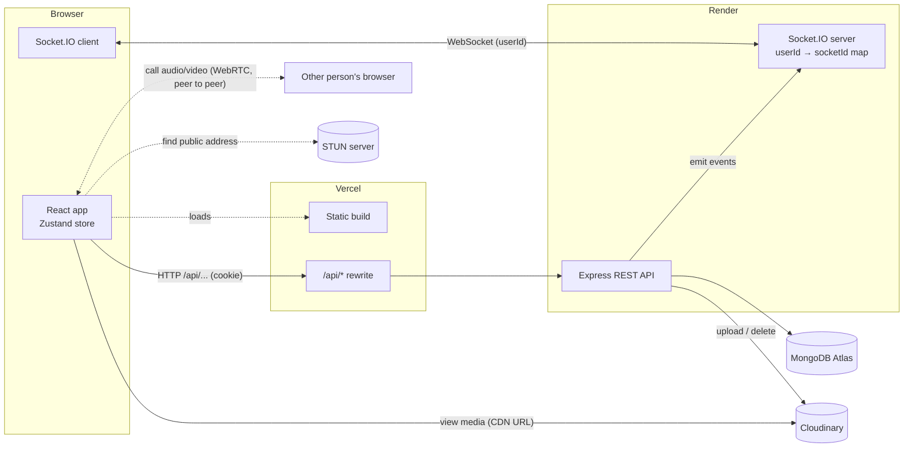
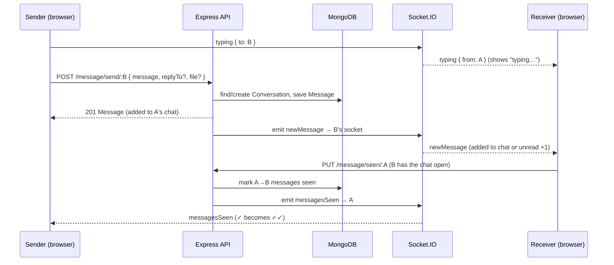
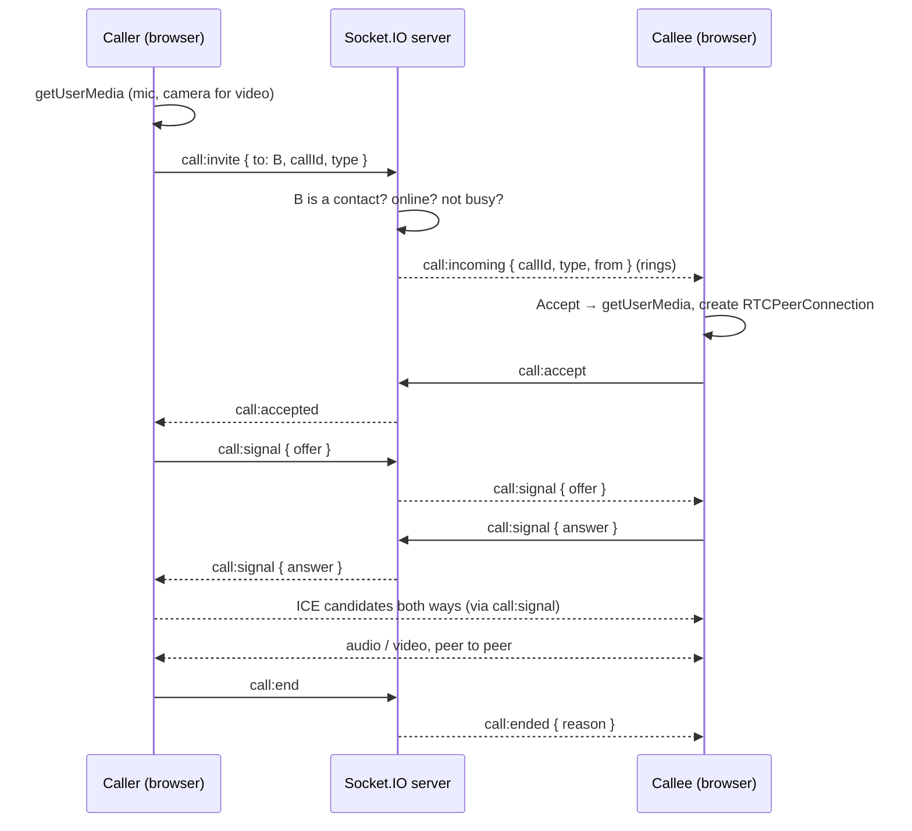
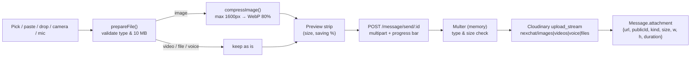
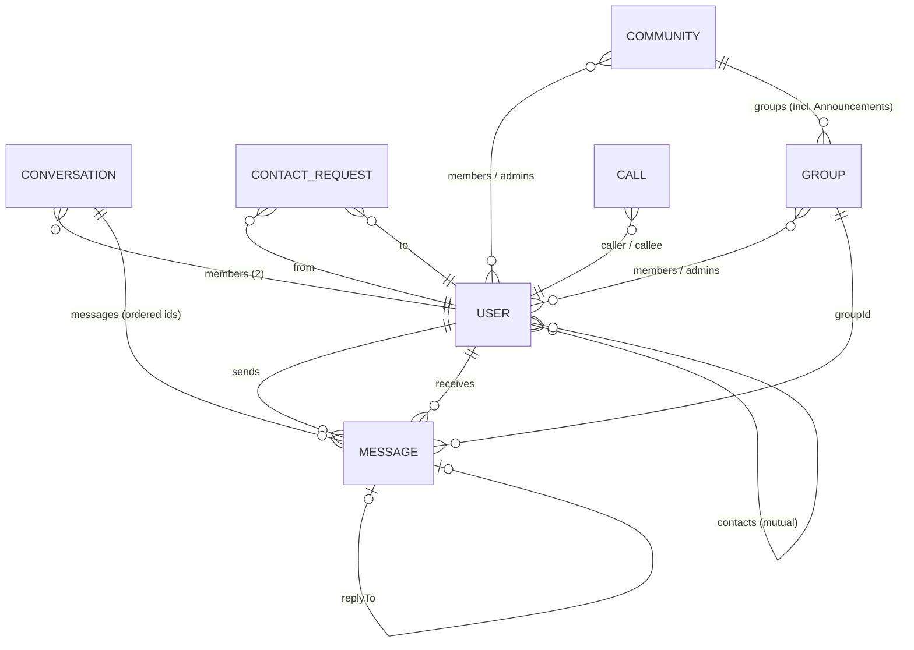

# NexChat

**A real-time messenger built with React, Node.js, Socket.IO, MongoDB and Cloudinary.**

NexChat is a full-stack chat application with instant delivery, a built-in AI assistant, group chats and communities, voice and video calls, private contacts (added by username or QR code), live presence, typing indicators, read receipts, replies, emoji reactions, editing, forwarding, voice notes, camera capture, photo and file sharing, notes to self, profile photos, and dark/light themes. It is designed to feel like a native messenger in the browser while staying within free hosting tiers.

| Service | URL |
|---|---|
| Frontend (Vercel) | https://nex-chat-six.vercel.app |
| Backend API (Render) | https://nexchat-4zi1.onrender.com |
| Repository | https://github.com/Arjun-SN04/NexChat |

---

## Contents

1. [Features](#features)
2. [Tech stack](#tech-stack)
3. [Architecture](#architecture)
4. [How it works](#how-it-works)
5. [Data model](#data-model)
6. [API reference](#api-reference)
7. [Real-time events](#real-time-events)
8. [Project structure](#project-structure)
9. [Getting started](#getting-started)
10. [Deployment](#deployment)
11. [Security](#security)
12. [Limits and known trade-offs](#limits-and-known-trade-offs)
13. [Roadmap](#roadmap)

---

## Features

### Messaging
- **Real-time delivery** over WebSockets (Socket.IO). Messages appear instantly for both people.
- **Replies** to a specific message, shown as a quote. Clicking the quote scrolls to the original and highlights it.
- **Editing** in the main input box (the message is highlighted while you edit). Allowed for **10 minutes** after sending, enforced on the server.
- **Deleting** a single message, several at once, or a whole conversation. Every delete asks for confirmation.
- **Emoji picker** in the composer with every emoji, search, categories and skin tones. Emoji are inserted at the cursor.
- **Reactions** with any emoji: quick picks, a longer list, or the full picker (one reaction per person per message; double-click a message for a quick ❤️).
- **Message actions**: hovering a message shows a small bar with **React**, **Reply** and **⋯ More** (Copy, Forward, Translate, Remind me, Edit, Select, Delete). With a mouse, clicking a message doesn't pin the bar; on touch screens a tap shows it and tapping elsewhere hides it.
- **Forwarding** one or many messages to up to 20 people at once. Forwarded messages are labelled.
- **Multi-select** mode (hover menu → Select, or long-press on touch) to copy, forward or delete several messages.
- **Copy** message text with one click.
- **Message grouping**: consecutive messages from the same person within 5 minutes are grouped, with date dividers ("Today", "Yesterday", or the date).

### Media
- **Photos, videos and documents** (PDF, Word, Excel, PowerPoint, text, CSV, zip) up to 10 MB. Attach with the paperclip, paste from the clipboard, or drag and drop onto the chat.
- **Camera capture**: take a photo with the device camera (front/back switch on phones), retake or use it.
- **Voice notes**: record up to 2 minutes from the microphone, with an inline player (play/pause, seek, duration).
- **In-browser image compression** before upload (typically 90%+ smaller).
- **Full-screen photo viewer**.

### Nexa, the AI assistant
- **Nexa** is a built-in assistant pinned in the chat list (under "Message yourself"). Ask how to use NexChat, or anything else: writing a message, ideas, explanations, summaries.
- Answers come as short bullet points (drafts to send come as a quote you can copy). Nexa never uses em or en dashes. The chat looks like any other NexChat conversation.
- Ask **"What can you do?"** (or open Nexa for the first time) to see a capability card: Send messages, Reminders, Schedule messages, Manage scheduled, Catch up, Write and rewrite, Translate, NexChat help, plus what Nexa adds to every chat. Tapping an example puts it in the box to edit before sending. It remembers the conversation, so follow-up questions work. Suggestion chips help you start; the chat is private to you and can be cleared.
- **Nexa can act for you** (ask in plain words):
  - *Send a message*: "tell Arjun I'm running 10 minutes late".
  - *Schedule a message*: "wish Priya happy birthday tomorrow at 9am". Times use your own time zone.
  - *Reminders*: "remind me at 6pm to call mom" (arrives in your Message yourself chat).
  - *List or cancel* scheduled messages: "what do I have scheduled?", "cancel the birthday one".
  - *Catch up*: "summarize my chat with Arjun" or a group.
  - Each action shows a card in the chat (Scheduled / Sent / Cancelled) with **Cancel** and **Open chat**.
- **Nexa in your chats** (no need to open Nexa):
  - *Smart replies*: 2–3 one-tap replies above the message box for the last message someone sent you.
  - *Catch me up*: open a chat with 5+ unread messages and a "Catch me up · 9 new" button appears in the header; tap it for a short summary of what you missed and what needs your reply.
  - *Translate*: from a message's ⋯ menu, into your browser's language, shown under the original (or "Already in English").
  - *Transcribe*: voice notes get a Transcribe button (Groq Whisper). The text is saved, so everyone in the chat sees it and summaries include it.
  - *Remind me*: from a message's ⋯ menu: in 1 hour, in 3 hours, tomorrow 9 AM, or a custom time. The reminder arrives in your Message yourself chat with **Go to message**.
  - *@Nexa in any chat*: type `@Nexa` (a suggestion pops up after `@`) and Nexa answers right there as a reply. In a group everyone sees it ("@Nexa pick a restaurant from what we said"); in a one-to-one chat both people see it ("@Nexa what does this word mean?"); in Message yourself it's just for you. As soon as you send it, a **"Nexa is thinking…"** bubble (and header and chat-list status) appears for you and the other person until the answer arrives. Nexa's bullets are formatted in the chat.
- **✨ Rewrite with Nexa** in every chat's message box: *Shorten*, *More professional*, *Friendlier*, *Fix spelling & grammar*, *Translate to English*, with **Undo**.
- **Scheduled bar**: a chat with scheduled messages shows "2 scheduled messages · next Fri 9:00 AM" above the message box, with the list and Cancel buttons.
- Powered by **Groq**'s free API (`openai/gpt-oss-120b`, falling back to `openai/gpt-oss-20b`). The API keys stay on the server.

### Groups and communities
- **Groups**: create a group from your contacts with a name and description. Everything works in groups: replies, reactions, files, voice notes, edit/delete/forward, and typing ("Priya is typing…"). Each message shows who sent it.
- **Admins** can rename the group, add contacts, remove people, and make others admin. Anyone can leave; the group always keeps at least one admin.
- **Communities** bring related groups together. Creating one adds an **Announcements** group where only admins post and every member is included. Admins add people and create groups inside the community; members see all its groups and can **join** any of them.
- Groups and communities appear in the chat list and in a **Groups** tab (each community with its groups underneath). Unread counts, previews and changes (new groups, renames, members joining or leaving) update live.

### Calls
- **One-to-one voice and video calls** with any contact, started from the chat header.
- **Full-screen call view**: incoming call with Accept / Decline and a ringtone, "Calling…" with a ringback tone, then a running timer.
- **In-call controls**: mute, camera on/off, hang up. Video calls show the other person full screen and your camera in a corner.
- **Clear outcomes**: declined, no answer (30 s), missed, offline, busy (already on a call), couldn't connect, or microphone/camera blocked.
- Audio and video go **directly between the two browsers** (WebRTC); the server only rings and passes connection details.
- **Call history in the chat**: every call appears in the conversation as a call bubble ("Missed voice call", "Video call · 3:12", "Voice call · No answer") with a call-back button, and in the chat list preview. Missed calls count as unread.
- **Calls tab**: a recent-calls list (incoming, outgoing, missed, with duration), grouping repeated calls ("Missed (2)"), search, call-back buttons, a **New call** picker, and "Clear call log". A badge shows missed calls you haven't looked at yet.

### Presence and status
- **Online indicators** for every contact.
- **Typing indicator** in the chat header, the contact list, and as an animated bubble in the chat.
- **Read receipts**: ✓ sent, ✓✓ seen (updates live when the other person opens the chat).
- **Unread counts** per contact and in the browser tab title, stored on the server so they survive a reload.

### Contacts and privacy
- **Contacts only**: you only see, message and call people in your contacts. Nobody can browse everyone who signed up.
- **Usernames**: every account has a unique `@username`, chosen at sign-up and editable in Profile.
- **Add by username**: send a contact request; the other person accepts or declines it. Requests arrive live, with a badge and a banner.
- **Invite link and QR code**: share your link or QR code (copy, share, WhatsApp, or save the QR image). Opening it adds you to each other instantly. The link can be reset at any time.
- **Remove contact** from the contact info panel (chat history is kept).
- **Message yourself**: a private chat pinned at the top for notes, links and files.

### Navigation
- **Section rail** on the left (WhatsApp-style) with **Chats**, **Calls** and **Communities**, each with a badge (unread chats, new missed calls, unread community messages). Theme, settings, log out and your profile sit at the bottom. On phones it becomes a bottom tab bar.
- **Communities tab**: each community with its Announcements preview and unread count, plus "View all" to open the community.
- Contact list with **last message preview** and time, sorted by most recent chat.
- **Search** (press `/` anywhere) and **All / Online / Unread** tabs.
- **Contact info panel** (username, email, join date, clear chat, remove contact).
- **Welcome screen** with people who are online right now.
- **Jump to latest** button with a new-message counter when you scroll up.
- **Resizable sidebar**: starts at about a third of the window (400–500px), can be dragged from 360px up to 640px (or about half the window), and double-click resets it.
- **Responsive**: one panel at a time on phones, with back navigation.

### Account
- Sign up, sign in, sign out (JWT in an HTTP-only cookie).
- **Stay signed in**: sessions last 30 days and renew automatically while you use the app. If a session does expire, the app returns to the sign-in page instead of showing empty data.
- **Profile photo** upload, change and remove (cropped and compressed in the browser).
- Change display name, username and password.
- **Dark theme by default**, with a light theme toggle in the app and on the landing page (remembered per browser).

### Website
- Landing page in dark and light, with a theme toggle, a feature showcase that cycles through the app's features over a photo, smooth scrolling (Lenis), parallax photos and scroll-in animations.
- Animated page transitions, a page title per screen, and a custom favicon. The logo's three dots do a small typing wave on load and while hovered.

---

## Tech stack

### Frontend
| Technology | Purpose |
|---|---|
| React 19 + Vite 7 | UI and build tooling |
| Tailwind CSS v4 (+ daisyUI) | Styling, including a class-based dark mode variant |
| React Router 7 | Routing |
| Zustand | Global chat state (open chat, messages, unread counts, typing, selection, etc.) |
| Socket.IO client | Real-time connection |
| Axios | HTTP requests (with upload progress) |
| React Hook Form | Form validation |
| Motion (Framer Motion) | Page transitions, dialogs and UI animation |
| Lenis | Smooth scrolling on the landing page |
| react-icons (Lucide set) | Icons |
| emoji-picker-react | Full emoji picker (loaded only when first opened) |
| qrcode.react | Invite QR codes |
| react-markdown + remark-gfm | Formatting Nexa's replies (no raw HTML) |
| Browser APIs | WebRTC `RTCPeerConnection` (calls), `MediaRecorder` (voice notes), `getUserMedia` (camera/mic), Web Audio (ringtones), Canvas (image compression), Clipboard, Web Share |

### Backend
| Technology | Purpose |
|---|---|
| Node.js + Express 5 | REST API |
| Socket.IO | WebSocket server |
| MongoDB Atlas + Mongoose 9 | Database |
| bcryptjs | Password hashing |
| jsonwebtoken + cookie-parser | Authentication |
| Multer | Multipart uploads (kept in memory, streamed to Cloudinary) |
| Cloudinary | Media storage and delivery (CDN) |
| Groq API (OpenAI-compatible) | Nexa answers, called with Node's built-in `fetch` |

### Hosting
| Service | Role |
|---|---|
| Vercel | Frontend (static build + `/api` proxy) |
| Render | Backend (supports long-lived WebSocket connections) |
| MongoDB Atlas | Database |
| Cloudinary (free plan) | Photos, videos, voice notes, files, profile photos |
| Groq (free tier) | AI model behind Nexa |
| Google public STUN | Lets two browsers find each other for calls (optional TURN server for strict networks) |

---

## Architecture



**Two channels, one source of truth.**

- **HTTP (REST)** does every change: send, edit, delete, react, forward, mark as seen, upload. The server validates the request and writes to MongoDB.
- **WebSockets** only push the result of those changes to the *other* person (and presence/typing signals). The sender updates its own screen from the HTTP response.
- In production the browser calls `/api/...` on the Vercel domain and Vercel rewrites it to Render. That keeps the auth cookie **same-site**, so `SameSite=Strict` works. In development, Vite's proxy does the same thing (`/api` → `localhost:3000`).
- The socket connects directly to the backend (`VITE_SOCKET_URL`), identifying itself with the user's id.
- **Calls are the exception to "HTTP does every change"**: ringing and connection setup (WebRTC offer/answer/ICE) go over the socket, and the audio/video itself flows directly between the two browsers. The server never sees call media.

### Sending a message (sequence)



### Making a call (sequence)



---

## How it works

This section explains the approach behind each feature.

### Authentication
- **Sign up** hashes the password with bcrypt (10 salt rounds). **Sign in** compares the hash.
- On success the server signs a **JWT** (`{ user_id }`, valid 30 days) and sets it as an **HTTP-only cookie** (`jwt`, `SameSite=Strict`, 30-day `maxAge` so it survives closing the browser). JavaScript can't read it, which protects it from XSS.
- Every protected route runs the `secureRoute` middleware. It verifies the cookie, loads the user (without the password) and attaches it as `req.user`. If the token is more than a day old it issues a fresh one, so **active users are never signed out**. Missing, invalid or expired tokens get a `401`.
- On the client, an axios interceptor in `AuthProvider` treats any `401` as "signed out": it clears the saved profile and the app shows the sign-in page. On load, the saved profile is refreshed from `GET /user/me`.
- The browser keeps a copy of the public user profile in `localStorage` (`chatUser`) so the UI knows who is signed in after a reload. Password hashes are never sent to the browser.
- Logging out clears the cookie, the stored profile, and the chat state.

### Contacts, usernames and invites
- Each user has a unique, lowercase `username` (3–20 characters: letters, numbers, `_`, `.`), a `contacts` list (always mutual) and a secret `inviteToken`.
- **Requests**: `POST /contacts/requests { username }` creates a `ContactRequest`. The other person gets a `contactRequest` event and sees it in the Requests tab. Accepting adds each person to the other's `contacts` and deletes the request; declining or cancelling just deletes it. If both people request each other, they are connected at once.
- **Lookup is exact**: `GET /contacts/lookup/:username` only finds an exact username and never returns a stranger's email, so the user list can't be browsed.
- **Invite link / QR**: the link is `/invite/<inviteToken>`. Opening it (after signing in, if needed; the token is remembered through sign-in) calls `POST /contacts/invite/:token`, which connects both people immediately. `POST /contacts/invite/reset` issues a new token, so old links and QR codes stop working.
- **Enforcement**: the contact list endpoint, sending, forwarding and calling all check `contacts` on the server. Profile changes (`userUpdated`) are only sent to your contacts.
- **Existing data**: `backend/scripts/migrate-contacts.js` gives every user a username and invite token, and makes people who already had a chat into contacts.

### Groups and communities
- A **Group** document holds `members`, `admins`, an optional `community`, an `announcement` flag, and `reads` (when each member last read it). Group messages are ordinary `Message` documents with a `groupId` instead of a `receiverId`, so replies, reactions, attachments, editing, deleting and forwarding all reuse the same code.
- **Who hears about changes**: a helper (`notifyAudience`) sends message events to every group member, or to the other person in a direct chat. Group membership changes send `groupAdded`, `groupUpdated` and `groupRemoved`.
- **Unread counts** for a group are the messages from others newer than my `reads` entry. Opening the group calls `PUT /groups/:id/read`. Group messages show a single ✓ (no per-member read receipts).
- **Rules on the server**: only contacts can be added to normal groups; only community members to community groups; only admins can edit, add, remove, change admins or delete; announcement groups accept posts from admins only and can't be left on their own (leave the community instead).
- A **Community** holds `members`, `admins` and its `announcements` group. Adding someone adds them to Announcements too; removing someone (or leaving) takes them out of every group in it. Community admins are the Announcements admins.
- The browser keeps groups and communities in the Zustand store. The sidebar summary (`loadConversations`) loads direct chats and groups together, so previews and unread badges work the same for both.

### Message yourself
- A self chat is a conversation whose two members are the same user. It is looked up with an exact match (`members.0` and `members.1` both = me), because `$all: [me, me]` would match every chat I'm in.
- Notes to self are saved as already seen (never unread), are not echoed back over the socket, show no read ticks or typing indicator, and have their own empty-state screen.

### Calls
- `CallProvider` (mounted once for the whole app) owns the call state machine: `ringing → connecting → active → ended`, plus the local/remote media streams. `CallScreen` renders the full-screen UI from that state.
- **Ringing and signalling** go over Socket.IO (`call:invite`, `call:accept`, `call:decline`, `call:end`, `call:signal`). The server keeps an in-memory `activeCalls` map to reject calls to people who are busy or offline, only relays signals between the two people in a call, and ends the call if either side disconnects.
- **Media** uses WebRTC. The caller creates the offer after the callee accepts; ICE candidates that arrive early are queued until the remote description is set. Google's public STUN servers are used by default; a TURN server can be added with `VITE_TURN_URL`, `VITE_TURN_USERNAME` and `VITE_TURN_CREDENTIAL`.
- **Call history**: the server keeps `{ caller, callee, type, startedAt, answeredAt }` for each call in `activeCalls` and, once it ends, `logCall` (in `utils/callLog.js`) saves a `Call` record and a chat `Message` with a `call` field (`type`, `status`, `duration`), then sends `newMessage` and `callLogged` to both people. Status is `answered` (with talk time), `declined`, or `missed` (no answer, cancelled, callee offline or busy). Only missed calls are unread. The Calls tab reads `GET /calls`; clearing it only hides calls for you.
- **Timeouts**: an unanswered call ends after 30 s (shown as "No answer" to the caller and "Missed call" to the callee). Ringtones are generated with the Web Audio API, so there are no sound files.

### Nexa (AI assistant)
- **Flow**: the browser posts the question to `POST /ai/messages`. The server saves it, sends Groq a system prompt (who the user is, and a list of NexChat features and what it does *not* have, so it doesn't invent buttons) plus the last 20 messages, saves the reply, and returns both. Nothing goes from the browser to Groq directly.
- **Keys**: `GROQ_API_KEYS` holds several comma-separated keys. `utils/groq.js` spreads requests across them and moves to the next key when one is rate-limited (429), rejected or erroring, then tries the fallback model. If everything is busy, the user sees "Nexa is busy right now" and their question is put back in the box.
- **Tools (actions)**: Nexa uses Groq's tool calling. The server gives the model five tools (`send_message`, `schedule_message`, `list_scheduled_messages`, `cancel_scheduled_message`, `get_recent_messages`), a list of the user's contacts and groups with their ids, and the user's local time and time zone (sent by the browser). It runs up to 5 rounds: the model asks for a tool, the server runs it with the **user's own permissions** (contacts only, group members only, admins-only announcements), and sends back the result. Actions are saved on the answer and shown as cards. The model is told to ask a short question when the person or time is unclear, and never to claim success unless a tool returned ok.
- **Scheduled messages** are stored in `ScheduledMessage`. A job (`utils/scheduler.js`) checks every 10 seconds, claims each due message (so it can't be sent twice), sends it through the same delivery code (`utils/deliver.js`), and marks it sent or failed. The sender gets `scheduledUpdated` events so cards and the chat's scheduled bar update live.
- **In-chat helpers** share `utils/chatAccess.js`, which reads a chat only if the user is in it and turns messages into text, including voice note transcripts. Smart replies and translation use the faster `openai/gpt-oss-20b`. Each helper has its own per-minute limit.
- **Transcription** downloads the voice note from Cloudinary and sends it to Groq's `whisper-large-v3-turbo`. The transcript is saved on the message and sent to the chat as `messageEdited`.
- **@Nexa** is a hidden bot account (`isBot: true`, random password, can't be found by username; the names `nexa`, `nexa.ai`, `nexchat`, `admin`, `support` and `system` are reserved). When a message mentions `@Nexa`, the server shows "Nexa is typing…", reads recent messages (40 in groups, 30 in direct chats), and posts Nexa's answer as a reply (at most 6 answers per chat per minute, one at a time). In one-to-one chats the answer is a message with `botChat: [personA, personB]`, so both people receive it live, can react to it, and see it in the right chat.
- **Style rules**: the system prompt asks for bullet points and bans em/en dashes, and `tidy()` in `utils/groq.js` also replaces any that slip through (number ranges become hyphens, the rest commas). "What can you do?" is answered instantly from a fixed list, without calling Groq.
- **Time zone**: the browser sends `X-Time-Zone` with every request, so Nexa understands times like "tomorrow 9am".
- **Rewrite** (`POST /ai/rewrite`) sends just the draft with a style instruction and returns only the rewritten text.
- **Limits**: 4,000 characters per question and 12 questions per minute per user, to protect the free quota. The gpt-oss models run with `reasoning_effort: low` and hidden reasoning, so answers come back in about 1–2 seconds.

### Emoji
- The composer's emoji button and the reaction picker's "All emojis" button share one picker (`FullEmojiPicker` in `EmojiPopover.jsx`). It is loaded with `React.lazy`, so its ~80 KB (gzipped) only downloads the first time someone opens it.

### Real-time connection and presence
- After sign-in, `SocketProvider` opens one Socket.IO connection with `?userId=...`.
- The server keeps an in-memory map `userId → socketId` and broadcasts the list of online ids (`getOnlineUsers`) whenever someone connects or disconnects. Green dots and the Online tab come from this list.
- To deliver an event to a person, the server looks up their socket id in the map and emits to it.
- All client listeners live in one hook, `useListenMessages`, mounted once by the chat layout. It reads the latest store state with `getState()`, so it never misses events and never registers twice.

### Conversations and messages
- A **Conversation** document links two members and keeps an ordered list of message ids. It is created automatically on the first message.
- Opening a chat loads all its messages (`GET /message/get/:id`).
- **Grouping** is done in the browser. Messages from the same sender, on the same day and within 5 minutes, form a group. Bubble corners and spacing adapt, and the time is shown once per group.
- **Sidebar previews** come from `GET /message/conversations`, which returns the last message and the unread count for each conversation. It is refreshed after edits, deletes and clears. New and sent messages update it instantly.
- **Smart scrolling**: the list jumps to the bottom when you open a chat, follows new messages only if you are already near the bottom (or you sent it), and otherwise shows a "jump to latest" button with a count.

### Typing indicator
- While you type, the composer emits `typing { to }` once, then `stopTyping` after 2.5 s without a keypress, on send, or when you switch chats. The server simply relays these to the other person.
- The receiver shows "typing…" and clears it on `stopTyping`, on the next message, or after a 4 s safety timeout.

### Read receipts and unread counts
- Each message has a `seen` flag. When you open a chat (or come back to the browser tab with it open), the client calls `PUT /message/seen/:id`. The server marks that person's messages to you as seen and emits `messagesSeen` to them, which turns their ✓ into ✓✓.
- Unread counts are computed on the server (`seen: false` messages addressed to you, grouped by sender), so they survive reloads. While you're online, `newMessage` events add to the count instantly.

### Replies, editing and the 10-minute window
- A reply stores `replyTo` (the original message id). The server checks the original belongs to the same two people. The quote is resolved in the browser from the loaded messages, so edits to the original show up in the quote, and a deleted original shows "Original message was deleted".
- Editing loads the text into the main composer with a context strip ("Edit message"). Enter saves, Esc cancels, and ↑ in an empty box edits your last message.
- The **10-minute edit window** is enforced by the server (`EDIT_WINDOW_MS` in `message.controller.js`), so it can't be bypassed. The client mirrors it (`utils/messages.js`) to hide the Edit button, re-checking every 15 s.

### Reactions
- Stored on the message as `reactions: [{ userId, emoji }]`, at most **one per person**. Choosing the same emoji removes it, and a different one replaces it.
- The client updates instantly (optimistic update), then applies the server's answer, and rolls back if the request fails. The other person receives `messageReacted`.
- The server only accepts emoji characters and only from the two people in the chat.

### Selecting, forwarding and deleting
- Selection mode is held in the store (`selectionMode`, `selectedIds`). The composer is replaced by a bar with Copy / Forward / Delete.
- **Bulk delete** (`POST /message/delete-many`) only deletes messages you sent. The other person gets one `messagesDeleted` event.
- **Forward** (`POST /message/forward`) copies messages into each recipient's conversation with `forwarded: true`. **Media is not re-uploaded**: the copies point to the same Cloudinary file, so forwarding costs no extra storage.

### Media pipeline (photos, videos, files, voice notes, camera)



- **Compression happens in the browser** with a canvas. Photos are resized to at most 1600px and re-encoded as WebP (JPEG fallback); a 1.6 MB photo typically becomes about 130 KB. GIFs are left untouched so they still animate, and the original is kept if compression wouldn't help.
- **Camera**: `getUserMedia` streams the camera into a `<video>`. A canvas captures the frame (mirrored for selfies), and the photo goes through the same compression and preview.
- **Voice notes**: `MediaRecorder` records Opus audio at about 32 kbps (roughly 240 KB per minute), with a 2-minute cap (auto-sent at the limit). Cloudinary stores audio as a "video" resource in `nexchat/voice`.
- **Server checks**: Multer accepts only allowed MIME types (no SVG) and at most 10 MB, then the buffer is streamed straight to Cloudinary. Nothing is written to the server's disk.
- **Display**: images are shown from their stored URL with their real aspect ratio (no layout jump), and open in a full-screen viewer. Videos and voice notes use `preload="none"`, so nothing downloads until you press play. Files show a download card.

### Keeping Cloudinary within the free plan
- Compress before upload (photos and profile photos).
- **No Cloudinary transformations** are used (no on-the-fly resizing), so viewing costs only bandwidth, not transformation credits.
- Videos and voice notes load only on play.
- **Deleting frees storage.** Deleting a message, bulk delete, clearing a chat, and replacing or removing a profile photo all delete the file from Cloudinary.
- **Shared files are reference-counted.** Because forwarded copies share one file, it is only deleted once no remaining message uses it (`releaseAttachments`).

### Profile photos
- The browser **centre-crops** the chosen image to a square and shrinks it to 400px WebP (typically a few dozen KB).
- `PUT /user/avatar` uploads it to `nexchat/avatars`, saves `{ url, publicId }` on the user, and deletes the previous photo. `DELETE /user/avatar` removes it and falls back to initials.
- The server broadcasts `userUpdated`, so everyone's contact list, chat header and message avatars update live. Name changes use the same event.

### Theme (dark / light)
- **Dark is the default.** `ThemeProvider` stores the choice in `localStorage` (`chatTheme`); light is used only if the visitor picked it.
- On the landing page, chat, profile and invite screens, `useThemeClass` adds the `dark` class to `<html>`. Tailwind's class-based `dark:` variant then applies everywhere, including dialogs rendered into `<body>` through portals. The sign-in and sign-up pages stay light (`useLightPage`).
- A small script in `index.html` applies dark mode before React loads, so refreshing never flashes white. When moving between two dark pages, switching back to light is delayed briefly so the page doesn't flicker between them.

### Landing page and transitions
- Route changes are wrapped in `AnimatePresence` for fade/slide page transitions. Each page sets its own tab title via `usePageTitle`.
- The landing page uses Lenis for smooth scrolling and Motion for parallax (`useScroll`/`useTransform`) and scroll-in reveals. Both respect the system's *reduce motion* setting.

---

## Data model



**User**
| Field | Type | Notes |
|---|---|---|
| fullName | String | required |
| email | String | required, unique |
| username | String | unique, lowercase, `[a-z0-9_.]{3,20}` |
| password | String | bcrypt hash, never returned by the API |
| contacts | [ObjectId → User] | always mutual; never returned by the API |
| inviteToken | String | unique secret for the invite link / QR; never returned except to its owner |
| isBot | Boolean | true only for the Nexa account that answers @Nexa in groups |
| avatar | `{ url, publicId }` \| null | profile photo on Cloudinary |
| createdAt / updatedAt | Date | timestamps |

**ContactRequest**
| Field | Type | Notes |
|---|---|---|
| from / to | ObjectId → User | unique per pair; deleted when accepted, declined or cancelled |
| createdAt / updatedAt | Date | timestamps |

**Group**
| Field | Type | Notes |
|---|---|---|
| name / description | String | up to 60 / 300 characters |
| members / admins | [ObjectId → User] | up to 256 members; always at least one admin |
| community | ObjectId → Community \| null | set for groups inside a community |
| announcement | Boolean | the community's admins-only Announcements group |
| reads | Map userId → Date | last time each member read it (unread counts) |
| createdBy, createdAt / updatedAt | | |

**AiMessage**
| Field | Type | Notes |
|---|---|---|
| user | ObjectId → User | whose AI chat it belongs to |
| role | `user` \| `assistant` | |
| content | String | the question or the reply (Markdown) |
| actions | [object] | what Nexa did for this answer (`sent`, `scheduled`, `cancelled`, `failed`), shown as cards |
| createdAt | Date | |

**ScheduledMessage**
| Field | Type | Notes |
|---|---|---|
| sender | ObjectId → User | |
| receiver / group | ObjectId → User / Group | exactly one; receiver can be the sender (reminders) |
| text | String | up to 4000 characters |
| sendAt | Date | up to a year ahead |
| status | `pending` \| `sending` \| `sent` \| `cancelled` \| `failed` | |
| sentMessage / error | | the delivered message, or why it failed |
| ref | object \| null | for "Remind me about this": the message it points back to |

**Call**
| Field | Type | Notes |
|---|---|---|
| caller / callee | ObjectId → User | |
| type | `voice` \| `video` | |
| status | `answered` \| `missed` \| `declined` | |
| startedAt / answeredAt / endedAt | Date | |
| duration | Number | seconds of talk time |
| hiddenFor | [ObjectId → User] | people who cleared it from their Calls list |

**Community**
| Field | Type | Notes |
|---|---|---|
| name / description | String | |
| members / admins | [ObjectId → User] | up to 1000 members |
| announcements | ObjectId → Group | created with the community |

**Conversation**
| Field | Type | Notes |
|---|---|---|
| members | [ObjectId → User] | the two participants (the same user twice for "Message yourself") |
| messages | [ObjectId → Message] | in send order |

**Message**
| Field | Type | Notes |
|---|---|---|
| senderId / receiverId | ObjectId → User | `receiverId` is empty for group messages |
| groupId | ObjectId → Group \| null | set for group messages |
| call | `{ type, status, duration }` \| null | set for call history entries |
| transcript | String \| null | voice note text, after someone taps Transcribe |
| botChat | [ObjectId → User] | on Nexa's answers in a one-to-one chat: the two people it belongs to |
| ref | `{ messageId, chatId, isGroup, chatName }` \| null | a reminder's link back to the original message |
| message | String | text (may be empty when there is an attachment) |
| edited | Boolean | shows "edited" |
| replyTo | ObjectId → Message \| null | reply target |
| seen | Boolean | read receipt / unread count |
| forwarded | Boolean | shows "Forwarded" |
| reactions | `[{ userId, emoji }]` | one per person |
| attachment | object \| null | `url, publicId, resourceType, kind (image/video/audio/file), name, size, mimeType, width, height, duration` |
| createdAt / updatedAt | Date | timestamps |

---

## API reference

All routes except sign up, sign in and sign out require the `jwt` cookie. The frontend calls them under `/api/...` (proxied).

### Users — `/user`
| Method | Path | Body | Description |
|---|---|---|---|
| POST | `/signup` | `{ fullName, username, email, password, confirmPassword }` | Create an account and sign in |
| POST | `/login` | `{ email, password }` | Sign in (sets cookie) |
| POST | `/logout` | – | Sign out (clears cookie) |
| GET | `/allusers` | – | My contacts (same as `GET /contacts`) |
| GET | `/username-available/:username` | – | `{ available, error }` for the live username check (no auth needed) |
| GET | `/me` | – | My profile |
| PUT | `/update` | `{ fullName?, username? }` or `{ currentPassword, newPassword }` | Update name, username or password |
| PUT | `/avatar` | multipart `avatar` (JPG/PNG/WebP, ≤ 2 MB) | Upload or replace my profile photo |
| DELETE | `/avatar` | – | Remove my profile photo |

### Contacts — `/contacts`
| Method | Path | Body | Description |
|---|---|---|---|
| GET | `/` | – | My contacts |
| GET | `/lookup/:username` | – | Find someone by exact username, with how they relate to me (`none`, `outgoing`, `incoming`, `contact`, `self`) |
| GET | `/requests` | – | `{ incoming, outgoing }` contact requests |
| POST | `/requests` | `{ username }` | Send a request (connects at once if they already asked me) |
| POST | `/requests/:id/accept` | – | Accept a request |
| DELETE | `/requests/:id` | – | Decline (received) or cancel (sent) a request |
| DELETE | `/:userId` | – | Remove a contact (both sides; history is kept) |
| GET | `/invite` | – | My invite token |
| POST | `/invite/reset` | – | New invite token (old link and QR stop working) |
| GET | `/invite/:token` | – | Who an invite link belongs to |
| POST | `/invite/:token` | – | Use an invite link (connects both people) |

### Groups — `/groups`
| Method | Path | Body | Description |
|---|---|---|---|
| GET | `/` | – | My groups, each with `lastMessage` and `unread` |
| POST | `/` | `{ name, description?, memberIds }` | Create a group with my contacts |
| GET | `/:id` | – | Group details (members populated) |
| PUT | `/:id` | `{ name?, description? }` | Edit (admins) |
| DELETE | `/:id` | – | Delete the group and its messages (admins) |
| POST | `/:id/members` | `{ userIds }` | Add people (admins) |
| DELETE | `/:id/members/:userId` | – | Remove someone (admins), or leave (my own id) |
| PUT | `/:id/admins/:userId` | `{ admin: true \| false }` | Make or remove an admin (admins) |
| POST | `/:id/join` | – | Join a group in a community I'm in |
| GET | `/:id/messages` | – | `{ messages, people }` (people = everyone who sent a message) |
| POST | `/:id/messages` | JSON or multipart, same as direct messages | Send to the group |
| PUT | `/:id/read` | – | Mark the group as read |

### Communities — `/communities`
| Method | Path | Body | Description |
|---|---|---|---|
| GET | `/` | – | My communities, each with its groups and whether I've joined them |
| POST | `/` | `{ name, description?, memberIds? }` | Create a community (and its Announcements group) |
| GET | `/:id` | – | Details with members populated |
| PUT | `/:id` | `{ name?, description? }` | Edit (admins) |
| DELETE | `/:id` | – | Delete the community, its groups and their messages (admins) |
| POST | `/:id/members` | `{ userIds }` | Add my contacts (admins) |
| DELETE | `/:id/members/:userId` | – | Remove someone (admins), or leave (my own id) |
| PUT | `/:id/admins/:userId` | `{ admin: true \| false }` | Make or remove an admin (admins) |
| POST | `/:id/groups` | `{ name, description?, memberIds? }` | New group inside the community (admins) |

### Nexa (AI assistant) — `/ai`
| Method | Path | Body | Description |
|---|---|---|---|
| GET | `/messages` | – | My AI chat history |
| POST | `/messages` | `{ message, timeZone }` (≤ 4000 chars) | Ask (Nexa may run tools); returns `{ question, answer }` with `answer.actions` |
| DELETE | `/messages` | – | Clear my Nexa chat |
| POST | `/rewrite` | `{ text, style }` (`shorten`, `professional`, `friendly`, `grammar`, `english`) | Rewrite a draft; returns `{ text }` |
| GET | `/scheduled` | `?chat=<id>` and/or `?all=1` | My scheduled messages (pending only unless `all`) |
| DELETE | `/scheduled/:id` | – | Cancel a pending scheduled message |
| GET | `/bot` | – | Nexa's bot account id (to show its group messages as "Nexa") |
| POST | `/smart-replies` | `{ chatId }` | Up to 3 short replies to the last message someone sent me there |
| POST | `/catch-up` | `{ chatId, count }` | Short summary of the latest `count` messages |
| POST | `/translate/:messageId` | `{ language }` (e.g. `hi-IN`) | Translation of one message |
| POST | `/transcribe/:messageId` | – | Transcribe a voice note (saved on the message) |
| POST | `/remind/:messageId` | `{ sendAt }` | Reminder in my Message yourself chat, linking back to the message |

### Calls — `/calls`
| Method | Path | Body | Description |
|---|---|---|---|
| GET | `/` | – | My recent calls (newest first, up to 200), with caller and callee |
| DELETE | `/` | – | Clear my call log (hidden only for me) |

### Messages — `/message`

Sending and forwarding only work to your contacts (or yourself). Edit, delete, react and forward also work on group messages; forwarding accepts `groupIds` as well as `receiverIds`.

| Method | Path | Body | Description |
|---|---|---|---|
| GET | `/get/:userId` | – | All messages with a person |
| POST | `/send/:userId` | JSON `{ message, replyTo? }` or multipart `message`, `replyTo?`, `file` | Send text and/or a file |
| PUT | `/edit/:messageId` | `{ message }` | Edit (own message, within 10 min) |
| DELETE | `/delete/:messageId` | – | Delete one of my messages |
| POST | `/delete-many` | `{ ids: [] }` (≤ 50) | Delete several of my messages |
| DELETE | `/conversation/:userId` | – | Clear a conversation (and its files) |
| GET | `/conversations` | – | Last message + unread count per conversation |
| PUT | `/seen/:userId` | – | Mark that person's messages to me as seen |
| POST | `/forward` | `{ messageIds: [], receiverIds: [] }` (≤ 50 / ≤ 20) | Forward messages |
| PUT | `/react/:messageId` | `{ emoji }` | Add, change or remove my reaction |

---

## Real-time events

The socket connects with `?userId=<id>`.

| Event | Direction | Payload | Purpose |
|---|---|---|---|
| `getOnlineUsers` | server → all | `[userId]` | Online presence |
| `userUpdated` | server → contacts | user | Name, username or profile photo changed |
| `contactRequest` | server → recipient | `{ _id, from }` | New contact request |
| `contactRequestRemoved` | server → other person | `{ _id }` | Request declined or cancelled |
| `contactAdded` | server → other person | user | Request accepted or invite link used |
| `contactRemoved` | server → other person | `{ userId }` | Removed from contacts |
| `newMessage` | server → receiver / group members | message | New (or forwarded) message; group messages have `groupId` |
| `messageEdited` | server → receiver | message | A message was edited |
| `messageDeleted` | server → receiver | messageId | One message deleted |
| `messagesDeleted` | server → receiver | `[messageId]` | Several messages deleted |
| `conversationDeleted` | server → receiver | `{ otherUserId }` | Chat cleared |
| `messagesSeen` | server → sender | `{ by }` | Turn ✓ into ✓✓ |
| `messageReacted` | server → other person | `{ messageId, reactions }` | Reaction changed |
| `typing` / `stopTyping` | client → server → receiver | `{ to, group? }` → `{ from, user?, name? }` | Typing indicator (for groups, `from` is the group and `name` is who's typing) |
| `groupAdded` | server → new members | group | Added to a group (or a new group was created) |
| `groupUpdated` | server → group members | group | Name, description, members or admins changed |
| `groupRemoved` | server → affected people | `{ groupId }` | Removed, left, or the group was deleted |
| `communityUpdated` | server → community members | `{ communityId }` | Community changed (reload it) |
| `communityRemoved` | server → affected people | `{ communityId }` | Removed, left, or the community was deleted |
| `call:invite` | client → server | `{ to, callId, type }` | Start ringing a contact (`voice` or `video`) |
| `call:incoming` | server → callee | `{ callId, type, from }` | Someone is calling |
| `call:accept` / `call:accepted` | callee → server → caller | `{ to, callId }` → `{ callId }` | Call answered |
| `call:decline` | callee → server | `{ to, callId }` | Call declined (caller gets `call:ended`) |
| `call:signal` | client → server → other person | `{ to, callId, data }` | WebRTC offer, answer or ICE candidate |
| `call:end` | client → server | `{ callId, reason? }` | Hang up or cancel |
| `call:ended` | server → client | `{ callId, reason }` | Call over: `ended`, `declined`, `missed`, `busy`, `offline`, `not-allowed` |
| `callLogged` | server → caller and callee | call | A call was saved (refreshes the Calls tab); the chat entry arrives as `newMessage` |
| `scheduledUpdated` | server → sender | `{ id, status }` | A scheduled message was created, sent, cancelled or failed |

---

## Project structure

```
NexChat/
├── service.sh                     # Start/stop backend + frontend in the background (logs in ./logs)
├── render.yaml                    # Render blueprint for the backend
├── backend/
│   ├── index.js                   # Express app, CORS, routes, MongoDB connection
│   ├── config/cloudinary.js       # Cloudinary config, Multer filters, upload/delete helpers
│   ├── controller/
│   │   ├── user.controller.js     # Auth, profile, username, profile photo
│   │   ├── contact.controller.js  # Contacts, requests, invite links
│   │   ├── group.controller.js    # Groups: create, members, admins, join, messages, unread
│   │   ├── community.controller.js  # Communities: members, admins, groups, announcements
│   │   ├── call.controller.js     # Call log: list and clear
│   │   ├── ai.controller.js       # Nexa: history, ask (system prompt, rate limit), clear
│   │   └── message.controller.js  # Send, edit, delete, seen, forward, react, summaries
│   ├── models/                    # user, conversation, message, contactRequest, group, community, call, aiMessage, scheduledMessage (Mongoose)
│   ├── routes/                    # /user, /contacts, /message, /groups, /communities, /calls and /ai routers
│   ├── middleware/secureRoute.js  # JWT cookie check → req.user
│   ├── jwt/token.js               # Sign JWT and set the cookie
│   ├── socket/socket.js           # Socket.IO server, presence map, typing relay, call signalling
│   ├── utils/username.js          # Username rules, generation, invite tokens
│   ├── utils/notify.js            # Send a socket event to a list of users
│   ├── utils/callLog.js           # Save a finished call (Call record + chat entry)
│   ├── utils/groq.js              # Groq client (tool calling) with key rotation and model fallback
│   ├── utils/nexaTools.js         # Nexa's tools: send, schedule, list/cancel, read a chat
│   ├── utils/deliver.js           # Send a message on someone's behalf (Nexa and scheduled messages)
│   ├── utils/scheduler.js         # Sends due scheduled messages every 10 seconds
│   ├── utils/chatAccess.js        # Read a chat the user is in as text (with transcripts); message access checks
│   ├── utils/nexaBot.js           # The hidden Nexa account used for @Nexa answers
│   ├── utils/nexaGroup.js         # Answer @Nexa mentions in groups and one-to-one chats
│   ├── scripts/migrate-contacts.js  # One-time upgrade: usernames, invite tokens, contacts from chats
│   └── seed.js                    # Sample users, contacts and conversations
└── frontend/
    ├── index.html                 # Fonts, favicon, meta
    ├── public/                    # favicon.svg, site.webmanifest, images/ (Unsplash photos + CREDITS.md)
    ├── vercel.json                # SPA routing + /api proxy to Render
    ├── vite.config.js             # Dev proxy /api → localhost:3000
    └── src/
        ├── App.jsx                # Routes + page transitions
        ├── index.css              # Tailwind, dark variant, chat background pattern
        ├── components/            # Landing, sign in/up, profile, invite page, shared UI (Button, Input, Card, …)
        ├── home/
        │   ├── ChatLayout.jsx     # Chat screen shell: theme, socket listeners, resizable sidebar
        │   ├── Avatar.jsx         # Photo or initials + online dot
        │   ├── ConfirmDialog.jsx  # Reusable confirmation dialog
        │   ├── leftpart/          # Sidebar: section rail / mobile tabs, Chats, Calls and Communities panels, Contacts dialog
        │   ├── rightPart/         # Chat: header, messages, bubble, composer (✨ rewrite, @Nexa hint), smart replies, catch-up card, scheduled bar, Nexa extras (translate, transcribe, remind), emoji picker, dialogs, media
        │   ├── groups/            # New group/community dialog, member picker, group info, community page
        │   ├── ai/AiChat.jsx      # Nexa chat panel
        │   └── call/CallScreen.jsx  # Full-screen incoming / outgoing / in-call view
        ├── context/               # Auth, socket, theme, call (WebRTC) providers + data hooks
        ├── hooks/                 # usePageTitle, useThemeClass / useLightPage, useVoiceRecorder
        ├── utils/                 # attachments, conversations, messages, contacts, groups, calls, callTones
        └── Zustand/UserConversation.js  # Global chat store
```

---

## Getting started

### Prerequisites
- Node.js 18+ (20+ recommended)
- A MongoDB database (Atlas free tier works)
- A Cloudinary account (free plan works) for media and profile photos

### 1. Clone and install
```bash
git clone https://github.com/Arjun-SN04/NexChat.git
cd NexChat
cd backend && npm install
cd ../frontend && npm install
```

### 2. Configure the backend
Create `backend/.env` (it is git-ignored):
```env
PORT=3000
MONGODB_URI=your_mongodb_connection_string
token=a_long_random_jwt_secret
FRONTEND_URL=http://localhost:5173

CLOUDINARY_CLOUD_NAME=your_cloud_name
CLOUDINARY_API_KEY=your_api_key
CLOUDINARY_API_SECRET=your_api_secret
CLOUDINARY_FOLDER=nexchat          # all media goes under this folder

# Nexa (free keys from https://console.groq.com/keys; several = more free quota)
GROQ_API_KEYS=gsk_key1,gsk_key2
GROQ_MODEL=openai/gpt-oss-120b

# Nexa images. Best: Cloudflare Workers AI FLUX (free 10,000 neurons/day, about 95-170 images, no watermark)
# dash.cloudflare.com > AI > Workers AI > "Use REST API": copy the Account ID and create a token
CLOUDFLARE_ACCOUNT_ID=
CLOUDFLARE_API_TOKEN=
NEXA_IMAGES_PER_DAY=15             # per person
# Fallbacks: Puter FLUX (npm run puter:login fills this in), then SubNP's free API (no key)
PUTER_AUTH_TOKEN=
# Nexa's web search uses Groq's built-in browser_search (gpt-oss models): no extra key
```

### 3. Run
Run both apps in the background with one command (ports 3000 and 5173 are freed first):
```bash
./service.sh start      # start both
./service.sh status     # is everything running?
./service.sh logs       # follow logs (or: logs backend / logs frontend)
./service.sh stop       # stop both
```
Or run them separately: `npm run dev` in `backend/` and in `frontend/`. Open http://localhost:5173.

Optional `frontend/.env` for calls on strict networks:
```env
VITE_TURN_URL=turn:your-turn-server:3478
VITE_TURN_USERNAME=...
VITE_TURN_CREDENTIAL=...
```

### 4. Sample data (optional)
```bash
cd backend && node seed.js
```
Creates 8 users with conversations (people who chat are already contacts), for example `priya@nexchat.com` / `priya123` and `rahul@nexchat.com` / `rahul123` (see `seed.js` for all). Usernames are the part of the email before `@`.

### 5. Upgrading an existing database
If your database was created before usernames and contacts existed, run this once:
```bash
cd backend && node scripts/migrate-contacts.js
```
It is safe to run again.

> Calls, the camera and the microphone only work on `localhost` or over HTTPS.

---

## Deployment

### Backend → Render
1. Create a Web Service (or use `render.yaml`). Root directory `backend`, build `npm install`, start `node index.js`.
2. Set environment variables: `MONGODB_URI`, `token`, `PORT`, `FRONTEND_URL` (your Vercel URL), `CLOUDINARY_CLOUD_NAME`, `CLOUDINARY_API_KEY`, `CLOUDINARY_API_SECRET`, `CLOUDINARY_FOLDER`, `GROQ_API_KEYS`, `GROQ_MODEL`, `NEXA_IMAGES_PER_DAY`, `CLOUDFLARE_ACCOUNT_ID`, `CLOUDFLARE_API_TOKEN` (optional: `PUTER_AUTH_TOKEN`).
3. If the production database predates contacts, run `node scripts/migrate-contacts.js` once against it.

### Frontend → Vercel
1. Import the repo with root directory `frontend`.
2. Set `VITE_SOCKET_URL` to the Render backend URL (and optionally `VITE_TURN_*` for calls).
3. Make sure `vercel.json` rewrites `/api/:path*` to your Render URL.

---

## Security

- Passwords are hashed with bcrypt and never returned by the API (older sessions that cached a hash in the browser are cleaned up on load).
- The session JWT lives in an HTTP-only, `SameSite=Strict` cookie. Enable `secure: true` in `jwt/token.js` when serving over HTTPS end to end.
- **Contacts only**: the server only lets you see, message, forward to and call your contacts. Usernames can only be looked up exactly, and strangers never see your email.
- Invite tokens are random and can be reset; contact lists and tokens are never sent to other users.
- Every message action checks ownership on the server: only the sender can edit (within 10 minutes) or delete, and only the two participants can react, reply or forward.
- Uploads are restricted by MIME type (SVG is blocked) and size, and are streamed to Cloudinary without touching the server disk.
- Cloudinary credentials and Groq API keys stay on the server (`backend/.env`, git-ignored); the browser never sees them.
- Nexa chats are private to each user, rate-limited per user, and the replies are rendered as Markdown without raw HTML.
- CORS only allows `localhost:5173` and `FRONTEND_URL`.
- Call audio and video are encrypted by WebRTC (DTLS-SRTP) and go peer to peer; the server only relays signalling between the two people in the call.

---

## Limits and known trade-offs

| Item | Value |
|---|---|
| Edit window | 10 minutes after sending |
| File size | 10 MB (Cloudinary free-plan limit) |
| Profile photo | 2 MB upload (the browser shrinks it to ~400px first) |
| Voice note | 2 minutes, ~32 kbps |
| Bulk delete / forward | 50 messages, 20 recipients |
| Message grouping | same sender within 5 minutes |
| Session | 30 days, renewed daily while in use |
| Username | 3–20 characters: `a-z`, `0-9`, `_`, `.` |
| Call ringing | 30 seconds, then "No answer" / "Missed call" |
| Nexa helpers | smart replies 30/min, translate 20/min, catch-up and transcribe 10/min per user; @Nexa 6 answers/min per chat |
| Nexa chat | 4,000 characters per question, 12 questions per minute, last 20 messages as context |
| Group size | 256 people |
| Community size | 1000 people |

- **One socket per user**: the presence map stores the latest connection, so with several tabs open only the newest receives live events (the others catch up on reload).
- **Whole-conversation loading**: a chat's messages are loaded at once (no pagination yet).
- **Read receipts** only apply to messages sent after the feature was added; older messages show a single ✓.
- **Calls are one-to-one** (no group calls yet).
- **Group read receipts**: group messages show a single ✓; there is no per-member "seen by" list.
- **Calls without TURN**: with only STUN, calls between some strict networks (corporate or mobile carrier NATs) can fail with "Couldn't connect". Add a TURN server to fix this.

---

## Roadmap

- [x] Voice and video calls
- [x] Private contacts with usernames, requests and QR invites
- [x] Call history in the chat and a Calls tab
- [x] Group chats and communities
- [x] AI assistant that can send, schedule and summarize
- [x] Smart replies, catch-up, translate, voice note transcripts, message reminders, @Nexa in groups
- [ ] Recurring scheduled messages, message search, streaming Nexa replies
- [ ] Group calls
- [ ] Group photos and invite links for groups
- [ ] Message pagination / infinite scroll
- [ ] Search inside a conversation
- [ ] Push notifications
- [ ] Multiple devices/tabs per user (socket rooms)
- [ ] "Delete for me" alongside "delete for everyone"

---

## Credits

- Landing and sign-in photos: [Unsplash](https://unsplash.com) (see `frontend/public/images/CREDITS.md`).
- Icons: [Lucide](https://lucide.dev) via react-icons.

## Author

**Arjun** — [GitHub](https://github.com/Arjun-SN04)

## License

MIT
